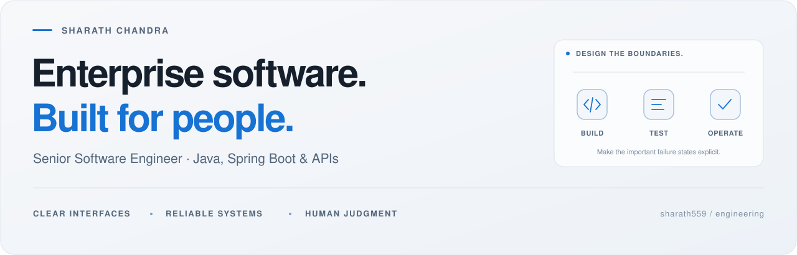

<picture>
  <source media="(prefers-color-scheme: dark)" srcset="assets/header-dark.svg">
  <source media="(prefers-color-scheme: light)" srcset="assets/header-light.svg">
  
</picture>

  <a href="#selected-work">Selected work</a> &nbsp; / &nbsp;
  <a href="#engineering-toolkit">Engineering toolkit</a> &nbsp; / &nbsp;
  <a href="#credentials">Credentials</a> &nbsp; / &nbsp;
  <a href="mailto:sharathy59@gmail.com">Get in touch</a>

## Software that earns trust.

I'm **Sharath Chandra**, a Senior Software Engineer with **10+ years of experience** building enterprise applications across healthcare, transportation, and business platforms.

My focus is **backend software engineering**: Java, Spring Boot, secure APIs, and dependable data flows. I also work across React and mobile interfaces. I'm expanding into **Claude integrations and agentic AI**, applying the same attention to data contracts, testability, and failure behavior.

  
  &nbsp;
  
  &nbsp;
  

## Selected work

Four projects, each with a different engineering question.

<table>
  <tr>
    <td width="50%" valign="top">
      <h3><a href="https://github.com/sharath559/talentscout">01 &nbsp; TalentScout</a></h3>
      
CLAUDE · PYTHON · PYDANTIC · PYTEST

      
<strong>How do you make an AI recommendation inspectable?</strong>

      
A candidate-evidence review workflow with exact source quotes, application-owned rubric scoring, estimated token-cost controls, and simulated human approval.

      
<strong>Evidence:</strong> 61 tests, 93% local coverage, and passing Python 3.10 / 3.12 / 3.14 CI. Reproducible offline demo; live model quality remains unmeasured.

      
<a href="https://github.com/sharath559/talentscout">Code</a> &nbsp;·&nbsp; <a href="https://github.com/sharath559/talentscout/blob/main/docs/ARCHITECTURE.md">Architecture</a> &nbsp;·&nbsp; <a href="https://github.com/sharath559/talentscout/blob/main/docs/demo.gif">Demo</a>

    </td>
    <td width="50%" valign="top">
      <h3><a href="https://github.com/sharath559/FlowPilot-Mobile">02 &nbsp; FlowPilot Mobile</a></h3>
      
REACT NATIVE · TYPESCRIPT · SQLITE · SUPABASE

      
<strong>What happens when the connection disappears?</strong>

      
An offline-first record-capture app. Local SQLite writes, a durable sync outbox, visible retry states, and organization-scoped cloud access keep the data flow explicit.

      
<strong>Engineering focus:</strong> mobile UX, local persistence, authentication, and Postgres row-level security. Pilot stage; two-way sync is roadmap work.

      
<a href="https://github.com/sharath559/FlowPilot-Mobile">Code</a> &nbsp;·&nbsp; <a href="https://github.com/sharath559/FlowPilot-Mobile/blob/main/docs/ARCHITECTURE.md">Architecture</a> &nbsp;·&nbsp; <a href="https://github.com/sharath559/FlowPilot-Mobile/blob/main/docs/OFFLINE_SYNC.md">Sync design</a>

    </td>
  </tr>
  <tr>
    <td width="50%" valign="top">
      <h3><a href="https://github.com/sharath559/decision-dna-ai">03 &nbsp; DecisionDNA AI</a></h3>
      
PYTHON · GEMINI · GOOGLE ADK · STREAMLIT

      
<strong>What changed, and why did a decision change?</strong>

      
A temporal decision-analysis prototype using synthetic healthcare scenarios. Models changes to policies, contracts, rules, and supporting evidence through a multi-agent workflow.

      
<strong>Engineering focus:</strong> structured decision states, deterministic comparisons, agent orchestration, and audit-oriented explanations.

      
<a href="https://github.com/sharath559/decision-dna-ai">Code</a> &nbsp;·&nbsp; <a href="https://github.com/sharath559/decision-dna-ai/blob/main/docs/ARCHITECTURE.md">Architecture</a> &nbsp;·&nbsp; <a href="https://github.com/sharath559/decision-dna-ai/tree/main/tests">Tests</a>

    </td>
    <td width="50%" valign="top">
      <h3><a href="https://github.com/sharath559/-sharath-event-talks-app">04 &nbsp; LaunchGuard AI</a></h3>
      
PYTHON · FLASK · JAVASCRIPT · CSS

      
<strong>What needs attention before deployment?</strong>

      
A review dashboard that checks project specifications for authentication, configuration, logging, and deployment gaps. Transparent heuristics produce a readiness assessment and actionable checklist.

      
<strong>Engineering focus:</strong> understandable risk feedback, full-stack implementation, and developer experience.

      
<a href="https://github.com/sharath559/-sharath-event-talks-app">Code</a> &nbsp;·&nbsp; <a href="https://github.com/sharath559/-sharath-event-talks-app/blob/main/app.py">Implementation</a> &nbsp;·&nbsp; <a href="https://github.com/sharath559/-sharath-event-talks-app#-getting-started">Run locally</a>

    </td>
  </tr>
</table>

**Also exploring:** [EchoAI](https://github.com/sharath559/echoAI), a conversational voice-interface prototype built with React, Node.js, and ElevenLabs.

## Engineering toolkit

| Area | Tools and practice |
| :--- | :--- |
| **Backend & APIs** | Java, Spring Boot, Spring Security, Python, Node.js, REST |
| **Data & identity** | PostgreSQL, Oracle, MongoDB, SQLite, Supabase, role-based access |
| **Delivery & operations** | GitHub Actions, Jenkins, Docker, AWS, Google Cloud, logging and monitoring |
| **Web & mobile** | React, TypeScript, React Native, Expo, interface design |
| **Growing in AI** | Claude Messages API, structured outputs, agent workflows, evaluation, human review |

## How I work

- **Start with the person.** Make important states, errors, and next steps understandable.
- **Make boundaries explicit.** Define data contracts, permissions, and failure behavior early.
- **Show the evidence.** Connect technical claims to source code, tests, and documented tradeoffs.
- **Design for reality.** Account for unreliable networks, incomplete inputs, cost, and operational limits.

## Credentials

<table>
  <tr>
    <td width="150" align="center" valign="middle">
      
    </td>
    <td valign="middle">
      
DEVELOPER CERTIFICATION

      <strong>Claude Certified Developer - Foundations</strong>
      
Issued by <strong>Anthropic</strong> to Sharath Chandra Yakara.

      <a href="https://www.credly.com/badges/1eea3cda-c4cd-4c00-8aba-780c43594aa7/linked_in_profile">Verify the credential on Credly →</a>
    </td>
  </tr>
  <tr>
    <td width="150" align="center" valign="middle">
      
    </td>
    <td valign="middle">
      
COURSE COMPLETION BADGE

      <strong>5-Day AI Agents: Intensive Vibe Coding Course</strong>
      
Kaggle · With Google · Completed July 30, 2026.

      
Hands-on learning in agent workflows, tools, memory, security, evaluation, and deployment, with assignments and a capstone project.

      <a href="https://www.kaggle.com/certification/badges/sharath559/108">View the earned badge →</a> &nbsp;·&nbsp; <a href="https://www.kaggle.com/learn-guide/5-day-agents-vibecoding">Course guide</a>
    </td>
  </tr>
</table>

## Let's build something useful.

Open to **backend and senior software engineering** opportunities. Especially interested in API platforms, reliable services, and teams bringing AI capabilities into useful products.

**[Email me](mailto:sharathy59@gmail.com)** &nbsp; / &nbsp; **[Explore my repositories](https://github.com/sharath559?tab=repositories)** &nbsp; / &nbsp; **[Kaggle](https://www.kaggle.com/sharath559)**

Portfolio projects are presented with their implementation status and limitations. Each repository contains the details.
