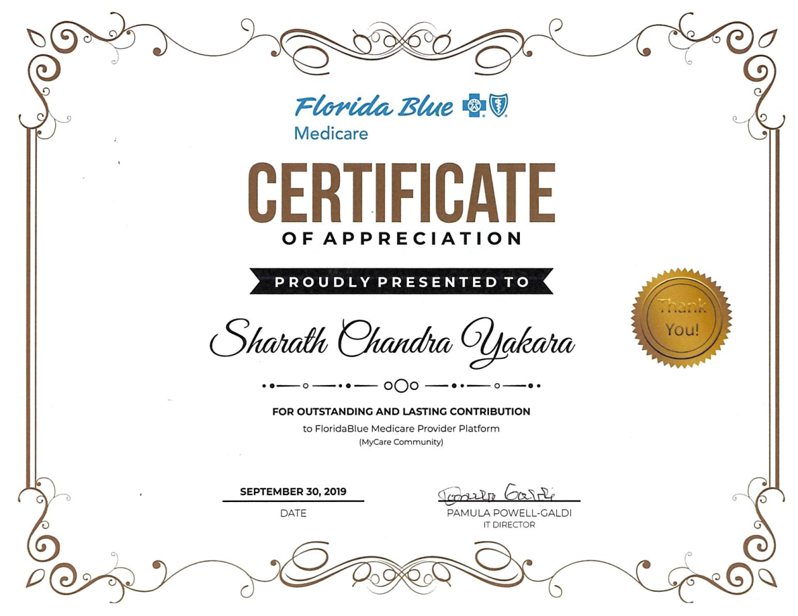
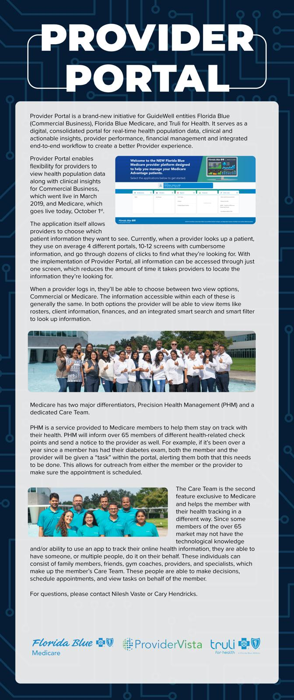

# Florida Blue · Provider Platform modernization

**2018–2019 project period · Healthcare enterprise software · Recognized September 30, 2019**

I worked on the **Florida Blue Provider Platform**, helping modernize fragmented legacy workflows into a consolidated application. This was enterprise application and identity-integration work, before my recent AI portfolio projects.

## The people and the problem

Providers needed patient and practice information spread across legacy applications. The supplied launch announcement describes a typical lookup spanning **four portals and 10–12 screens**, with repeated navigation to find the relevant details.

The initiative covered Florida Blue Commercial, Florida Blue Medicare, and Truli for Health. Its goal was to bring patient information, population-health insights, provider performance, finances, and related workflows into one place.

## My contribution

- Helped consolidate legacy application workflows into a single Florida Blue application so providers could find relevant information without moving between separate systems.
- Worked on **SAML-based single sign-on from Availity**: providers retained their existing Availity login and entered the Florida Blue application through a federated sign-in flow.
- Contributed to the Medicare Provider Platform (**MyCare Community**), receiving a Florida Blue Medicare Certificate of Appreciation on **September 30, 2019**.

These contribution details combine my account of the work with the recognition document. The broader product capabilities below describe the team's platform rather than sole ownership of every feature.

## What the team delivered

| Before | Consolidated provider experience |
| :--- | :--- |
| Patient lookup across four portals and 10–12 screens | A single screen bringing the relevant information together |
| Separate application entry points | Availity login with SAML-based access to the Florida Blue application |
| Information distributed across systems | Rosters, clinical information, finances, search, and filtering in one portal |
| Disconnected care follow-up | Medicare Precision Health Management tasks and Care Team workflows |

The historical announcement records a **March 2019 Commercial launch** and an **October 1 Medicare launch**. The certificate immediately preceding the Medicare launch is dated September 30, 2019.

## Why this was an organizational milestone

The Provider Portal connected previously fragmented information and workflows across Florida Blue Commercial, Florida Blue Medicare, and Truli for Health. The launch announcement positioned the platform as a consolidated provider experience covering population-health data, clinical insights, provider performance, financial management, and end-to-end workflows.

- **Less navigation:** the announcement contrasts four portals, 10–12 screens, and dozens of clicks with a consolidated single-screen view of relevant information.
- **Commercial and Medicare access:** providers could choose a business view and use rosters, patient/client information, finances, integrated search, and filtering.
- **Precision Health Management:** Medicare members aged 65 and older and their providers could receive tasks for overdue health checkpoints, supporting outreach and appointment scheduling. The announcement uses an overdue diabetes exam as an example.
- **Care Team:** designated supporters could help members manage care, schedule appointments, and view tasks on their behalf, including members who needed assistance with online tools.

These are product capabilities described in the historical announcement. They do not establish measured clinical outcomes or sole ownership of every feature.

## Scale and impact

- **Workflow scope:** four legacy portals and 10–12 screens consolidated into one screen, as described in the launch announcement. This is a product workflow comparison, not a measured time-savings percentage.
- **Company context:** Florida Blue reported **more than 5 million health care members statewide in July 2019**. This describes the insurer's membership, not the number of providers or active users of this application. [Florida Blue's July 29, 2019 announcement](https://www.floridablue.com/newsroom/Florida-Blue-Medicare-contract-with-The-Villages).
- **Recognition:** the IT Director's certificate credits an outstanding and lasting contribution to the Medicare Provider Platform.

Portal-specific adoption, provider counts, latency, revenue, and measured time savings are not documented in the supplied material.

## Recognition

[View the original certificate PDF](../assets/florida-blue/certificate-of-appreciation-2019.pdf).

## Original launch announcement

[Open the complete announcement at original size](../assets/florida-blue/provider-portal-launch-announcement-2019.jpg).

## Sources

- Original Florida Blue Medicare Certificate of Appreciation, supplied by me. The certificate names the **FloridaBlue Medicare Provider Platform (MyCare Community)** and IT Director **Pamula Powell-Galdi**.
- Historical **Provider Portal** announcement supplied with the profile update. It describes the legacy workflow, launch timing, consolidated portal, Precision Health Management, and Care Team capabilities.
- My account of the 2018–2019 modernization work and Availity/SAML sign-in integration.
- Florida Blue's dated 2019 newsroom announcement, linked above, for company membership context only.

Platform naming: Florida Blue identifies [Availity as its provider information-exchange partner](https://www.floridablue.com/providers/availity-online-services). The historical SAML implementation details above are from my account of the project.
